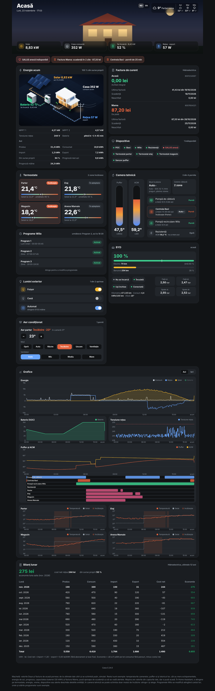
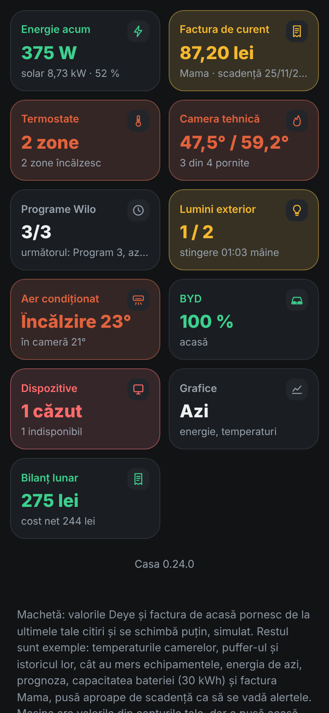
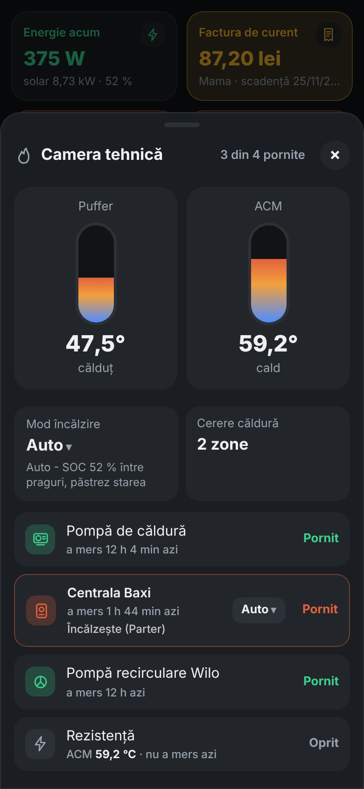
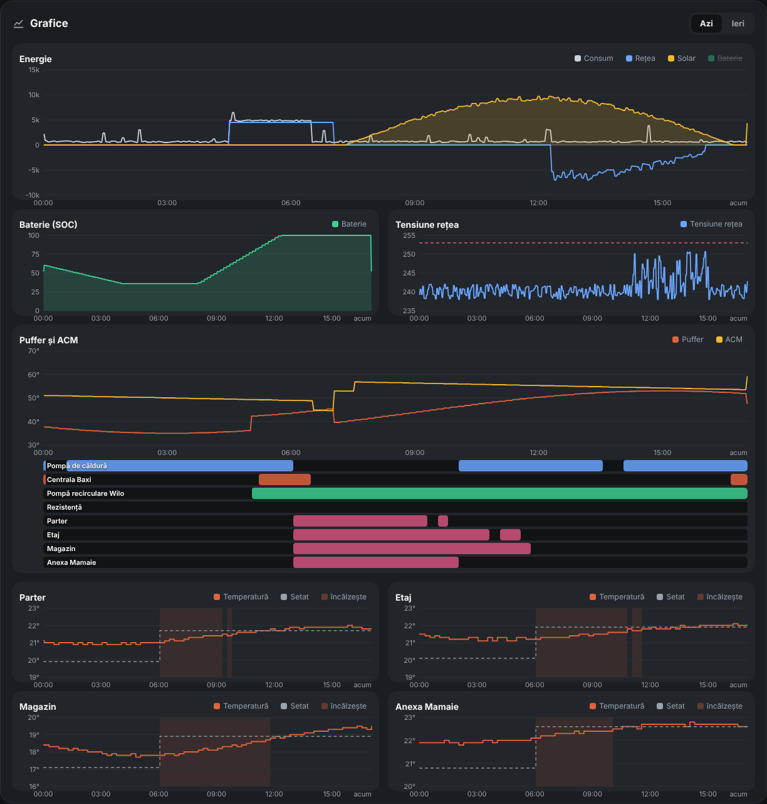
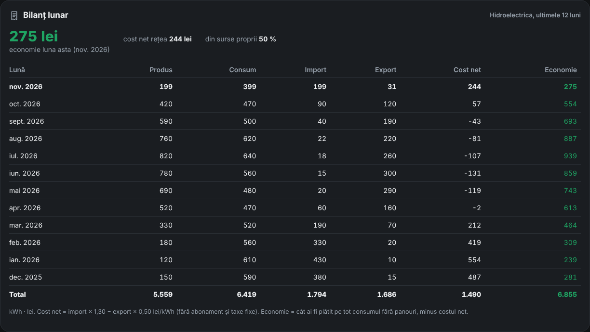

# Casa – dashboard pentru Home Assistant

Un panou de casă pentru Home Assistant, gândit pentru PC și pentru telefon: energie solară și baterie în timp real, facturi Hidroelectrica, termostate, camera tehnică (pompă de căldură, centrală, puffer, ACM), lumini, aer condiționat, mașină, grafice zilnice și bilanț lunar în lei. Totul se configurează din interfață, fără YAML.

*English summary at the end.*



| Telefon: plăci colorate după stare | Telefon: cardul se deschide într-o fereastră |
|---|---|
|  |  |





## Ce arată

- **Energie acum**: fluxul solar → casă / baterie / rețea, MPPT-uri, tensiunea rețelei, cât mai ține bateria, energia de azi și prognoza.
- **Factura de curent**: contractele Hidroelectrica, cu sold, scadență și ultima factură.
- **Termostate**: temperatura, temperatura setată, umiditatea și dacă zona cere căldură.
- **Camera tehnică**: puffer și ACM ca rezervoare, modul de încălzire, echipamentele (pornit / oprit, de cât timp, cât au mers azi).
- **Programe fixe** ținute pe un Shelly (componente virtuale), cu editor de ore.
- **Lumini exterior**, **aer condiționat** (orice entitate `climate`), **mașina** (prin OverDrive) și **dispozitive urmărite**.
- **Grafice pe zi** (de la 00:00, cu butoane **Azi / Ieri**): energie (consum, rețea, solar, baterie), baterie, tensiune rețea, puffer și ACM cu intervalele în care au mers echipamentele și termostatele, câte un grafic pe termostat.
- **Bilanț lunar** pe ultimele 12 luni: produs, consum, import, export, cost net și economie în lei, din prețurile de import și export introduse în Configurează → Energia de azi (din statisticile HA, fără senzori în plus).
- **Vremea** sus, cu prognoza pe 3 zile; la atingere se deschide [Clock Weather Card](https://github.com/pkissling/clock-weather-card), dacă e instalat din HACS (altfel fereastra standard).
- **Alerte** sus: dispozitive căzute, facturi aproape de scadență, baterie sau puffer sub prag.
- **Telefon**: plăci pe două coloane, colorate după stare; atingerea deschide cardul într-o fereastră de jos.
- Română și engleză, cu comutator în pagină.

## Instalare

### Prin HACS (recomandat)

1. HACS → ⋮ → **Custom repositories** → adaugă `https://github.com/Bdamian2301/casa-dashboard`, tip **Integration**.
2. Caută **Casa Dashboard** → **Download**, apoi repornește Home Assistant.

### Manual

Copiază folderul `custom_components/casa_dashboard` în `/config/custom_components/` și repornește Home Assistant.

## Configurare

**Setări → Dispozitive și servicii → Adaugă integrare → Casa.** Integrarea găsește singură ce poate (invertorul Deye, vremea, termostatele, mașina OverDrive), iar restul se completează în cinci pași: General, Energie, Energia de azi, Încălzire, Factură și dispozitive. Orice se poate schimba mai târziu din **Configurează**.

Câmpurile cu liste se scriu câte un element pe linie:

```text
Termostate          Parter = climate.parter
                    Magazin = climate.magazin = sensor.releu_magazin     (al doilea: când cere căldură)
Echipamente         Centrala = switch.centrala = alerta = input_select.centrala_mod = input_text.centrala_motiv
                    Rezistență = switch.rezistenta = sensor.temp_acm = ACM
Programe fixe       Program 1 = L-V = switch.p1 = number.p1_start = number.p1_stop   (ore HHMM: 545 = 05:45)
Contracte           Acasă = 8001234567
Lumini exterior     Foișor = switch.foisor
Aer condiționat     Aer parter = climate.ac_parter
```

Pentru **bilanțul lunar** completează la pasul *Energia de azi* senzorii de import / export zilnic și prețurile (lei/kWh, cu TVA). Senzorii trebuie să aibă `state_class: total_increasing` (cei de la Deye au).

Panoul apare în bara laterală (**Casa**). Poți folosi și cardul `custom:casa-card` într-un dashboard Lovelace, de exemplu ca pagină implicită.

### Integrări pe care le folosește (opțional)

Casa doar afișează entități existente; folosește ce ai:

- un invertor (testat cu Deye), pentru energie;
- integrarea Hidroelectrica, pentru facturi;
- termostate și relee (testat cu Shelly);
- [OverDrive](https://github.com/yash-srivastava/Overdrive-release) prin MQTT, pentru mașină;
- orice entitate `climate`, pentru aer condiționat (testat cu Tuya Smart IR AC).

Automatizările (pompă de căldură după baterie, centrală, lumini apus / răsărit etc.) nu fac parte din integrare: fiecare casă le are pe ale ei. Panoul le arată starea și motivul, dacă le dai entitățile.

## Licență

MIT – vezi [LICENSE](LICENSE).

---

## English

**Casa** is a home dashboard panel for Home Assistant, built for desktop and phone: live solar, battery and grid flow, Hidroelectrica (Romania) bills, thermostats, a boiler room view (heat pump, gas boiler, buffer and hot-water tanks), outdoor lights, air conditioning, an OverDrive car card, daily charts with Today / Yesterday, a 12-month balance in lei from your import and export prices, and a weather pop-up with Clock Weather Card (if installed). Everything is configured from the UI (Settings → Devices & services → Add integration → Casa). Install through HACS as a custom repository (type Integration) or copy `custom_components/casa_dashboard` to your config folder. Romanian and English, switchable on the page. MIT licensed.
